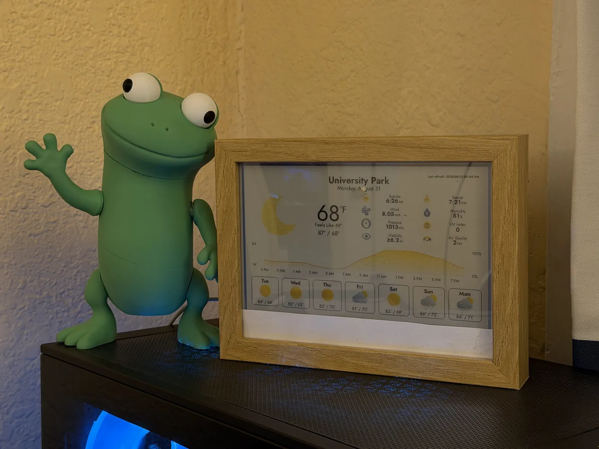

# InkyPi · WalJu's build

This is [Walton Cheung](https://walju.net)'s fork of [InkyPi](https://github.com/fatihak/InkyPi), running on a Raspberry Pi behind an e-ink display in a custom wooden frame. It shows weather and other live data, with local additions kept here alongside the upstream project.



## What's in this fork

- **Today dashboard:** Weather, the next three calendar events, a reminder, and optional MQTT readings on one screen. Each section is optional and unavailable sources are labelled independently. See the [Today setup guide](docs/today.md).
- **MQTT Dashboard:** Turns MQTT messages into tiles with current values, message age, and sparklines. It accepts numbers, text, and fields from JSON payloads. See the [setup guide](docs/mqtt_dashboard.md).
- **ESP32-S3 sensor node:** ESP-IDF firmware publishes chip temperature, Wi-Fi signal, free heap, uptime, and BOOT-button state to MQTT. See the [firmware guide](hardware/esp32-sensor-node/README.md). The chip temperature is a board diagnostic, not room temperature.
- **Bundled community plugins:** Plugin Manager, Duo Weather, Mini Weather, Literature Clock, and Windows PC Stats are included in `src/plugins/`. The [plugin credits and changes](docs/third_party_plugins.md) identify their authors and this fork's adjustments.
- **Windows PC Stats adjustments:** The layout scales to the configured display, and the included PowerShell sync script works with current Windows builds. Its default Pi destination is specific to this build; see the [plugin notes](docs/third_party_plugins.md) before using it on another device.

The upstream web interface, scheduled playlists, and plugins for clocks, weather, calendars, images, news, and comics are here too. AI Image is included. Year Progress, AI Text, GitHub, Hardware Buttons, Screenshot, To-Do List, Unsplash, and Wikipedia Picture of the Day have been removed from this build. Saved playlist entries for those removed plugins are dropped when the configuration loads, and saved with the next configuration update. Other plugin settings are retained.

This fork retains support for the display hardware handled by InkyPi's installer, including Pimoroni Inky and supported Waveshare e-paper models.

## Install on a Raspberry Pi

Prepare a Raspberry Pi with Raspberry Pi OS, a supported e-ink display, and network access. The [installation guide](docs/installation.md) covers OS imaging and initial network setup.

```bash
git clone https://github.com/realwalju/InkyPi.git
cd InkyPi
sudo bash install/install.sh
```

For a Waveshare display, pass its driver model to the installer, for example:

```bash
sudo bash install/install.sh -W epd7in3f
```

The installer configures the required interfaces and service, then prompts for a reboot. After rebooting, open the Pi's hostname with `.local` or its IP address in a browser to reach the web interface. See [troubleshooting](docs/troubleshooting.md) if setup fails.

To update an existing installation:

```bash
cd InkyPi
git pull
sudo bash install/update.sh
```

## Add live sensor data

The MQTT Dashboard needs an MQTT broker and a publisher. The [MQTT Dashboard guide](docs/mqtt_dashboard.md) walks through setting up Mosquitto on the Pi, adding broker credentials in InkyPi's **API Keys** page, and choosing topics and fields for tiles. The [ESP32-S3 firmware](hardware/esp32-sensor-node/README.md) is one publisher option; Home Assistant, zigbee2mqtt, Tasmota, or any other MQTT publisher can feed the dashboard.

## Develop and customize

- [Development without display hardware](docs/development.md)
- [Building InkyPi plugins](docs/building_plugins.md)
- [Bundled plugin sources and local changes](docs/third_party_plugins.md)
- [API keys](docs/api_keys.md)

This fork is based on [fatihak/InkyPi](https://github.com/fatihak/InkyPi). It is distributed under [GPL-3.0](LICENSE); bundled plugins and visual assets have their own credits and terms in [plugin credits](docs/third_party_plugins.md) and [attribution](docs/attribution.md). More of my projects are at [walju.net](https://walju.net).
